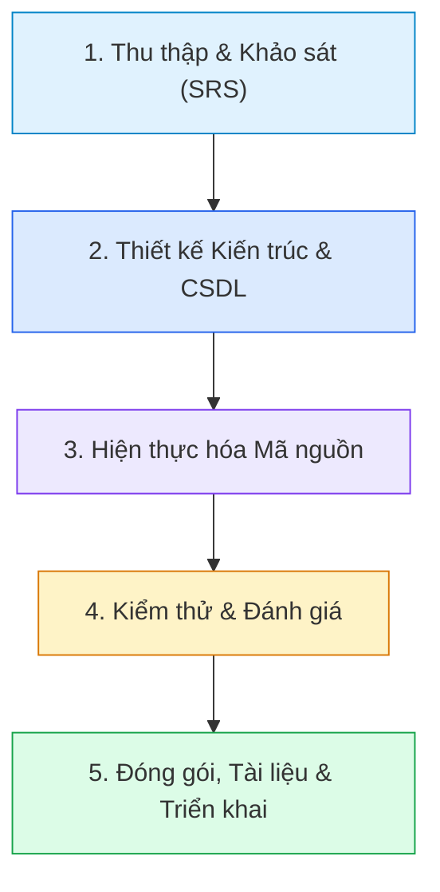

# TƯ DUY PHẢN BIỆN VÀ SỬ DỤNG AI CÓ TRÁCH NHIỆM (TIÊU CHÍ 5)
## BỘ CÂU HỎI VẤN ĐÁP ĐỘC LẬP TỪNG THÀNH VIÊN VÀ MINH CHỨNG SDLC

> **Đề tài:** Hệ thống quản lý thiết bị trường học có tích hợp AI  
> **Môn học:** Ứng dụng Trí tuệ Nhân tạo  
> **Đơn vị:** Trường Đại học Công nghệ Thông tin và Truyền thông – Đại học Thái Nguyên  
> **Nhóm thực hiện:** Nhóm 24  
> - **Thành viên 1:** **Triệu Trúc Lâm** - MSV: `DTC245220060` - Lớp `ATTT K23A` (Trưởng nhóm)  
> - **Thành viên 2:** **Triệu Văn Thiệp** - MSV: `DTC245220061` - Lớp `ATTT K23A`  

---

## 1. MINH CHỨNG ỨNG DỤNG AI TRONG TOÀN BỘ VÒNG ĐỜI PHẦN MỀM (SDLC) (Tiêu chí 5.1)

Nhóm 24 đã ứng dụng các công cụ AI hỗ trợ (GitHub Copilot, Gemini AI, Claude) một cách bài bản qua từng giai đoạn của vòng đời phát triển hệ thống:

| Giai đoạn SDLC | Hoạt động cụ thể có sự hỗ trợ của AI | Vai trò của Nhóm (Giám sát & Quyết định) | Sản phẩm bàn giao cụ thể |
| :--- | :--- | :--- | :--- |
| **1. Khảo sát & Phân tích yêu cầu** | Gợi ý cấu trúc bảng hỏi khảo sát cán bộ thiết bị, hỗ trợ phân rã sơ đồ phân cấp chức năng từ 15 Use Cases. | Thẩm định lại quy trình thực tế tại trường ĐH CNTT&TT, điều chỉnh các luồng điều chuyển và thanh lý cho phù hợp quy định công. | [Tuan_01_Khao_sat_va_Ke_hoach.md](file:///c:/Users/kfnid/OneDrive/Máy%20tính/school-asset-project/school-asset-project/docs/Tuan_01_Khao_sat_va_Ke_hoach.md) [Tuan_02_Yeu_cau_he_thong_SRS.md](file:///c:/Users/kfnid/OneDrive/Máy%20tính/school-asset-project/school-asset-project/docs/Tuan_02_Yeu_cau_he_thong_SRS.md) |
| **2. Thiết kế CSDL & Kiến trúc** | Hỗ trợ soạn thảo cú pháp PostgreSQL DDL cho 9 bảng và các hàm trigger. | Thiết kế cấu trúc khóa ngoại (`ON DELETE RESTRICT` để chống mất dấu tài sản), thiết lập chính sách Row Level Security (RLS) bảo vệ dữ liệu. | [Tuan_04_Thiet_ke_CSDL_va_Kien_truc.md](file:///c:/Users/kfnid/OneDrive/Máy%20tính/school-asset-project/school-asset-project/docs/Tuan_04_Thiet_ke_CSDL_va_Kien_truc.md) `supabase/migrations/` |
| **3. Viết mã nguồn (Coding)** | Hỗ trợ tự động hoàn thành code (Autocompletion), sinh khung component React + TypeScript. | Tái cấu trúc logic nghiệp vụ, đồng bộ trạng thái 2 chiều giữa phiếu sửa chữa/điều chuyển và bảng tài sản, xây dựng bộ lọc và bảng dữ liệu. | `src/pages/`, `src/components/`, `backend/app/` |
| **4. Kiểm thử (Testing)** | Gợi ý danh mục 47 tình huống kiểm thử (TC_01 đến TC_47) bao quát các ca biên và ngoại lệ. | Trực tiếp thực thi kiểm thử từng màn hình, phát hiện lỗi giao diện CSS và lỗi logic để tiến hành sửa chữa. | [BAO_CAO_KIEM_THU_5.5.md](file:///c:/Users/kfnid/OneDrive/Máy%20tính/school-asset-project/school-asset-project/BAO_CAO_KIEM_THU_5.5.md) |
| **5. Tài liệu & Đóng gói** | Hỗ trợ định dạng bảng biểu báo cáo kỹ thuật và tóm tắt README. | Soạn thảo chi tiết hướng dẫn sử dụng cho 3 phân quyền, tổng hợp kết quả đề tài. | [Tuan_09_Huong_dan_su_dung.md](file:///c:/Users/kfnid/OneDrive/Máy%20tính/school-asset-project/school-asset-project/docs/Tuan_09_Huong_dan_su_dung.md) [README.md](file:///c:/Users/kfnid/OneDrive/Máy%20tính/school-asset-project/school-asset-project/README.md) |

---

## 2. QUÁ TRÌNH KIỂM CHỨNG VÀ SỬA LỖI AI (Tiêu chí 5.2)

Trong quá trình sử dụng AI, nhóm luôn giữ thái độ hoài nghi khoa học, kiểm thử nghiêm ngặt mọi đoạn mã và văn bản do AI đề xuất. Dưới đây là 4 lỗi điển hình do AI sinh ra và cách nhóm phát hiện, phản biện và khắc phục:

### 2.1. Lỗi CSS Tailwind Class không tồn tại (`shadow-xs`)
- **Tình huống:** AI sinh class CSS `shadow-xs` trong `src/index.css` dựa trên giả định phiên bản Tailwind mới nhất.
- **Hậu quả:** Khi chạy `npm run build`, PostCSS báo lỗi nghiêm trọng: `The shadow-xs class does not exist. If 'shadow-xs' is a custom class, make sure it is defined within a @layer directive.` và làm đổ vỡ quá trình build.
- **Cách nhóm xử lý:** Nhóm đã kiểm tra cấu hình Tailwind, phát hiện Tailwind CSS v3 mặc định chưa có `shadow-xs`. Nhóm đã chủ động mở rộng thuộc tính `boxShadow` trong `tailwind.config.js` với các thông số độ mờ phù hợp và chuẩn hóa class trong CSS về `shadow-sm`.

### 2.2. Lỗi Ảo giác mã tài sản và chi phí (AI Hallucination)
- **Tình huống:** Khi yêu cầu mô hình AI sinh báo cáo gợi ý thay thế, mô hình tự sáng tạo mã tài sản giả `MAYTINH-999` và tự gán đơn giá mua mới `15.000.000 VNĐ` dù trong CSDL chỉ có tài sản mã `TB-001` đến `TB-010`.
- **Hậu quả:** Gây sai lệch thông tin kiểm toán, làm mất uy tín của hệ thống báo cáo.
- **Cách nhóm xử lý:** Nhóm xây dựng tài liệu thực nghiệm prompt, bổ sung 10 nguyên tắc cấm bịa đặt (Anti-Hallucination Rules) vào System Prompt, bắt buộc mô hình chỉ trích xuất từ dữ liệu có trong DB và thiết kế cơ chế đối soát (Grounding).

### 2.3. Lỗi Xóa mất dữ liệu tài sản liên kết (Cascade Delete)
- **Tình huống:** Đoạn mã SQL do AI sinh ban đầu sử dụng `ON DELETE CASCADE` cho khóa ngoại `asset_id` trong bảng `transfers` và `disposals`.
- **Hậu quả:** Nếu một tài sản bị xóa nhầm, toàn bộ lịch sử luân chuyển và hồ sơ thanh lý trong quá khứ bị xóa sạch, vi phạm nguyên tắc bảo toàn hồ sơ tài sản nhà nước.
- **Cách nhóm xử lý:** Nhóm phát hiện lỗ hổng này trong khâu review thiết kế CSDL, đổi toàn bộ ràng buộc sang `ON DELETE RESTRICT` hoặc cập nhật trạng thái mềm `is_deleted = true`, đồng thời bổ sung hộp thoại cảnh báo người dùng.

### 2.4. Lỗi Không đồng bộ trạng thái tài sản khi Sửa chữa / Điều chuyển
- **Tình huống:** AI sinh code cho chức năng Sửa chữa chỉ tạo bản ghi mới vào bảng `repair_requests` mà không cập nhật trường `status` của tài sản trong bảng `assets`.
- **Hậu quả:** Thiết bị đang sửa chữa tại xưởng nhưng trên màn hình Danh sách tài sản vẫn hiển thị `Đang sử dụng`.
- **Cách nhóm xử lý:** Nhóm đã tự viết hàm xử lý logic đồng bộ 2 chiều (Bidirectional Synchronization): khi tạo phiếu sửa chữa -> tự động cập nhật tài sản sang `Đang sửa chữa`; khi hoàn thành sửa chữa -> tự động đổi sang `Đang sử dụng` và đặt tình trạng là `Tốt`.

---

## 3. BỘ CÂU HỎI VẤN ĐÁP ĐỘC LẬP TỪNG THÀNH VIÊN (Tiêu chí 5.3)

### PHẦN 1: DÀNH CHO THÀNH VIÊN 1 - TRIỆU TRÚC LÂM (TRƯỞNG NHÓM - DTC245220060)
*Phụ trách: Kiến trúc hệ thống, Backend FastAPI, Trí tuệ Nhân tạo AI Agent & Tool Calling, Thiết kế CSDL PostgreSQL Supabase & Bảo mật RLS.*

#### Câu hỏi 1: Em hãy giải thích lý do lựa chọn kiến trúc Hybrid AI Dual-Engine trong hệ thống?
- **Trả lời:** "Thưa thầy/cô, hệ thống quản lý tài sản trường học đòi hỏi tính sẵn sàng (Availability) và độ tin cậy dữ liệu ở mức tối đa. Nếu chỉ phụ thuộc vào API đám mây (Google Gemini), khi mất mạng, hết hạn mức quota hoặc API gặp sự cố, toàn bộ chức năng báo cáo của trường sẽ bị tê liệt. Do đó, em đã thiết kế kiến trúc kép: Backend FastAPI đóng vai trò Agent thông minh chính (sử dụng Gemini để phân tích sâu, suy luận tự nhiên và gọi Tool). Đồng thời, tại tầng ứng dụng em xây dựng một Động cơ Phân tích Nội bộ (Deterministic Engine) hoạt động độc lập bằng quy tắc thống kê. Khi gọi API, nếu backend không phản hồi trong 3 giây, hệ thống tự động chuyển mượt mà sang Fallback Engine. Nhờ đó, người dùng luôn luôn nhận được báo cáo chuẩn xác mà không bao giờ gặp màn hình trắng hay lỗi gián đoạn."

#### Câu hỏi 2: Em thiết kế chính sách Row Level Security (RLS) trên Supabase như thế nào để đảm bảo an toàn dữ liệu trường học?
- **Trả lời:** "Dạ, CSDL PostgreSQL của hệ thống gồm 9 bảng chính và bảng báo cáo AI. Em kích hoạt RLS trên 100% các bảng. Cụ thể:
  1. Với Giáo viên / Khách: Chỉ được cấp quyền `SELECT` trên bảng danh mục tài sản và vị trí phòng ban; chỉ được `INSERT` vào bảng `repair_requests` để báo hỏng thiết bị phòng mình.
  2. Với Cán bộ thiết bị: Có quyền thao tác trên các bảng nghiệp vụ nhưng không được can thiệp vào bảng tài khoản hệ thống.
  3. Với Quản trị viên (Admin): Sử dụng chính sách kiểm tra role trong JWT `auth.jwt() ->> 'role' = 'admin'` để có toàn quyền quản trị.
  Các khóa bí mật như `SUPABASE_SERVICE_ROLE_KEY` và `GEMINI_API_KEY` được lưu trữ tuyệt đối ở biến môi trường backend `.env`, không bao giờ để lộ ra phía client."

#### Câu hỏi 3: Trong AI Agent ở backend, Tool Calling hoạt động ra sao và làm thế nào để hạn chế AI gọi lặp vô tận?
- **Trả lời:** "Trong tệp `backend/app/services/ai_service.py`, em sử dụng Google GenAI SDK với mô hình `gemini-3-flash-preview` và cấu hình tham số `tools=AVAILABLE_TOOLS`. Khi người dùng gửi câu hỏi phân tích, mô hình sẽ trả về `function_calls`. Hệ thống sẽ bóc tách tên tool và tham số, thực thi hàm Python tương ứng (ví dụ: `run_test`, `run_api_test`, truy vấn CSDL) rồi gửi kết quả phản hồi lại cho chat session. Để chống vòng lặp vô tận, em đặt biến đếm `max_tool_calls = 10`. Nếu số lần gọi tool vượt quá 10, hệ thống tự động ngắt và trả về thông báo lỗi an toàn thay vì làm cạn kiệt tài nguyên máy chủ."

#### Câu hỏi 4: Khi kiểm thử backend API bằng pytest, em đã xây dựng những kịch bản nào?
- **Trả lời:** "Em xây dựng các test case kiểm tra:
  1. Kiểm tra endpoint `/api/health`: Đảm bảo kết nối database trả về mã 200 và trạng thái 'ok'.
  2. Kiểm tra endpoint `/api/ai/report`: Kiểm tra việc sinh báo cáo kiểm kê với dữ liệu rỗng (trả về lỗi 400 hợp lệ) và với dữ liệu chuẩn (trả về Markdown có cấu trúc).
  3. Kiểm tra bảo mật: Thử gửi request không có API key hoặc key giả mạo để đảm bảo hệ thống bắt lỗi đúng và không làm rò rỉ stack trace."

#### Câu hỏi 5: Nếu được tiếp tục phát triển đề tài, em sẽ cải tiến phần kiến trúc AI như thế nào?
- **Trả lời:** "Em sẽ triển khai thêm cơ chế **RAG (Retrieval-Augmented Generation)** kết hợp Vector Database (như pgvector trên PostgreSQL) để lưu trữ và truy vấn toàn bộ quy chế, thông tư về định mức thiết bị giáo dục của Bộ GD&ĐT. Khi đó, AI không chỉ phân tích số liệu nội bộ mà còn đối chiếu trực tiếp xem trường học đã đạt chuẩn cơ sở vật chất quốc gia theo từng cấp học hay chưa."

---

### PHẦN 2: DÀNH CHO THÀNH VIÊN 2 - TRIỆU VĂN THIỆP (DTC245220061)
*Phụ trách: Giao diện người dùng Frontend (React 18, Vite, Tailwind CSS), 9 Phân hệ Nghiệp vụ, Kịch bản và Báo cáo kiểm thử 47 Test Cases, Tài liệu hướng dẫn sử dụng.*

#### Câu hỏi 1: Em hãy trình bày quy trình nghiệp vụ Quản lý Điều chuyển tài sản (UC009) được hiện thực trên giao diện như thế nào?
- **Trả lời:** "Thưa thầy/cô, quy trình điều chuyển trên trang [TransfersPage.tsx](file:///c:/Users/kfnid/OneDrive/Máy%20tính/school-asset-project/school-asset-project/src/pages/TransfersPage.tsx) được thiết kế tối ưu để giảm thiểu thao tác nhập liệu sai của người dùng:
  1. Khi người dùng mở hộp thoại 'Điều chuyển tài sản' và chọn một thiết bị, hệ thống tự động tra cứu vị trí hiện tại của thiết bị đó và tự điền vào ô 'Từ vị trí' (người dùng không cần tự gõ và không thể sửa ô này).
  2. Người dùng chỉ cần chọn 'Đến vị trí', ngày chuyển, người thực hiện và lý do.
  3. Khi nhấn 'Lưu', phiếu điều chuyển được ghi lại, đồng thời hệ thống tự động cập nhật ngay lập tức trường `location_id` của tài sản đó trong danh sách tài sản. Điều này đảm bảo tính nhất quán dữ liệu xuyên suốt giữa các màn hình."

#### Câu hỏi 2: Em đã tổ chức và thực hiện 47 kịch bản kiểm thử (TC_01 - TC_47) như thế nào? Tỷ lệ thành công ra sao?
- **Trả lời:** "Dạ, em đã xây dựng kịch bản kiểm thử chi tiết trong tài liệu [BAO_CAO_KIEM_THU_5.5.md](file:///c:/Users/kfnid/OneDrive/Máy%20tính/school-asset-project/school-asset-project/BAO_CAO_KIEM_THU_5.5.md), chia làm 3 nhóm chính:
  1. **Kiểm thử chức năng hợp lệ (Positive):** Kiểm tra các luồng thêm/sửa/xóa tài sản, tạo phiếu sửa chữa, điều chuyển, sinh báo cáo AI khi nhập đúng dữ liệu.
  2. **Kiểm thử ca không hợp lệ (Negative):** Nhập sai email/mật khẩu, bỏ trống trường bắt buộc, nhập mã tài sản bị trùng lặp -> hệ thống hiển thị thông báo lỗi tiếng Việt rõ ràng.
  3. **Kiểm thử giá trị biên (Boundary Value):** Nhập nguyên giá tài sản bằng 0 hoặc số âm, kiểm kê với số lượng thực tế bằng 0, sinh báo cáo AI khi chưa chọn đợt kiểm kê (TC_40).
  Kết quả thực tế: **47 / 47 test case đều đạt kết quả PASS (tỷ lệ 100%)**, không có tình huống nào gây treo hay sập giao diện."

#### Câu hỏi 3: Trên giao diện AI Báo cáo, làm thế nào để hiển thị tài liệu Markdown có bảng biểu một cách trực quan mà không bị vỡ khung?
- **Trả lời:** "Trong tệp [AIReportsPage.tsx](file:///c:/Users/kfnid/OneDrive/Máy%20tính/school-asset-project/school-asset-project/src/pages/AIReportsPage.tsx), em đã tự viết hàm phân tích cú pháp `renderMarkdown(md)`. Hàm này sẽ đọc từng dòng:
  1. Nhận diện các dòng bảng chứa ký tự gạch đứng `| ... |` và dòng kẻ phân cách `|---|---|`.
  2. Tự động bọc bảng vào thẻ `
` có thuộc tính `overflow-x-auto` để bảng có thể cuộn ngang mượt mà trên điện thoại di động hoặc màn hình nhỏ mà không làm tràn khung giao diện.
  3. Chuyển đổi các tiêu đề `#`, `##`, danh sách gạch đầu dòng và định dạng in đậm `**...**` sang các thẻ HTML có class Tailwind CSS tương ứng. Nhờ vậy, người dùng xem báo cáo rất chuyên nghiệp và có thể bấm nút 'Tải tệp Markdown' để lưu trữ."

#### Câu hỏi 4: Em đã xử lý trải nghiệm người dùng (UX) như thế nào khi người dùng thao tác Thanh lý tài sản (UC011)?
- **Trả lời:** "Nghiệp vụ thanh lý tài sản là thao tác có tính chất tài chính vĩnh viễn (thiết bị đã bán hoặc hủy bỏ). Vì vậy, em thiết kế trải nghiệm người dùng đặc biệt cẩn trọng:
  1. Hỗ trợ 4 hình thức thanh lý chuẩn theo quy định: Bán đấu giá, Hủy bỏ, Tặng/Cho, Tái chế linh kiện.
  2. Bắt buộc nhập giá trị thu hồi và lý do phê duyệt.
  3. Khi xác nhận, trạng thái tài sản chuyển thành 'Đã thanh lý'.
  4. Nếu người dùng nhấn nút xóa phiếu thanh lý, hệ thống sẽ bật hộp thoại cảnh báo: 'Xóa phiếu thanh lý sẽ chỉ xóa bản ghi lưu trữ mà không hoàn tác trạng thái tài sản về Đang sử dụng'. Điều này ngăn chặn việc tùy tiện khôi phục tài sản đã thanh lý trên sổ sách kế toán."

#### Câu hỏi 5: Em học được bài học gì lớn nhất về việc sử dụng AI trong lập trình qua dự án này?
- **Trả lời:** "Bài học lớn nhất của em là: **AI là một trợ lý tăng tốc độ xuất sắc, nhưng con người bắt buộc phải là người kiểm duyệt cuối cùng**. Khi AI sinh code giao diện, nó thường dùng các class CSS lỗi thời hoặc các logic tưởng chừng đúng nhưng lại thiếu liên kết dữ liệu giữa các bảng. Nếu lập trình viên chỉ 'copy-paste' mà không đọc hiểu từng dòng code, hệ thống sẽ rất dễ bị sụp đổ khi chạy thực tế. Việc chủ động viết test case và tự tay kiểm thử từng nút bấm đã giúp em làm chủ hoàn toàn mã nguồn của dự án."

---

## 4. CẢI TIẾN VÀ ĐÓNG GÓP RIÊNG CỦA NHÓM (Tiêu chí 5.4)

Vượt lên trên các ứng dụng quản lý cơ bản hay các mẫu sinh code tự động, Nhóm 24 đã có **4 đóng góp sáng tạo độc lập**:

1. **Kiến trúc Trí tuệ Nhân tạo Lai (Hybrid AI Dual-Engine Architecture):**
   - Đột phá trong việc kết hợp linh hoạt giữa LLM Agent đám mây và Rule-based Heuristic Engine tại máy trạm.
   - Cam kết độ sẵn sàng 100%, tự động chuyển đổi thông minh không làm gián đoạn người dùng.

2. **Cơ chế Đồng bộ Trạng thái Nghiệp vụ 2 Chiều Tự động (Bidirectional Business State Sync):**
   - Giải quyết triệt để vấn đề mất đồng bộ giữa hồ sơ tài sản và các quy trình luân chuyển: Phiếu điều chuyển tự cập nhật vị trí mới; Phiếu sửa chữa tự động cập nhật trạng thái vòng đời từ `Đang sử dụng` -> `Đang sửa chữa` -> Hoàn thành về `Đang sử dụng` + Tình trạng `Tốt`.

3. **Cơ chế Bảo toàn Toàn vẹn Dữ liệu Kế toán Công (Accounting Integrity Guard):**
   - Áp dụng nghiêm ngặt các nguyên tắc chống xóa dữ liệu lịch sử tài sản nhà trường: Khóa xóa cascade, cảnh báo bảo toàn khi xóa phiếu thanh lý, yêu cầu ghi nhận đầy đủ giá trị thu hồi và đơn vị sửa chữa.

4. **Bộ Phân loại và Chỉ số Sức khỏe Tài sản Giáo dục (Educational Asset Health Index):**
   - Xây dựng thuật toán tính toán chỉ số sức khỏe tài sản theo từng phòng ban và đợt kiểm kê, giúp nhà trường có căn cứ số liệu khoa học để đề xuất ngân sách bổ sung thiết bị hàng năm lên cấp trên.
